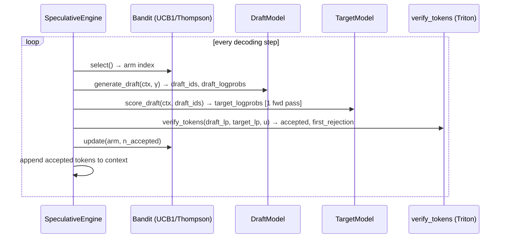

<h1 align="center">⚡ FlashSpec</h1>

<p align="center">
  <strong>Adaptive speculative-decoding inference engine for large language models</strong><br>
  Verification kernel and a pure-PyTorch reference · bandit draft selection · chi-squared output check
</p>

<p align="center">
  
  <a href="https://pypi.org/project/flashspec/">
    </a>
  <a href="https://pypi.org/project/flashspec/">
    </a>
  <a href="https://pepy.tech/project/flashspec">  </a>
  <a href="https://pepy.tech/project/flashspec">
    </a>
  <a href="https://flashspec.readthedocs.io">
    </a>
  <a href="https://doi.org/10.5281/zenodo.20766119">
    </a>
  <a href="./CITATION.cff">
    </a>
  <a href="./LICENSE">
    </a>
  <a href="https://hits.sh/github.com/Mattral/FlashSpec/">
  </a>
  <a href="https://github.com/Mattral/FlashSpec/tree/main/notebooks">
    
  </a>

</p>

---

> **Project status: alpha 0.1.5.** Correctness tests, including a
> chi-squared check that emitted tokens follow the target when the draft
> and target differ, are in the suite. The engine is currently slower
> than plain decoding. A CPU float32 run at git `f59b5b4` loaded
> TinyLlama-1.1B-Chat and Felladrin/Llama-160M-Chat-v1, tokenized
> HumanEval/23, and generated 16 new tokens with no warmup and one
> thread. FlashSpec measured 1.75 tok/s and vanilla
> autoregressive decoding measured 4.30 tok/s
> (`speedup_vs_ar_mean` 0.407). Acceptance was
> 0.114 with one drafter, so the bandit did not adapt, and
> the draft-plus-verify step cost more wall time than the tokens it
> kept. The Colab Tesla T4 float16 pair is in
> `benchmarks/results/tinyllama_gpu_flashspec_ucb_cb02ca1.json` and
> `benchmarks/results/tinyllama_gpu_vanilla_ar_cb02ca1.json`. Every H100
> number in this README is a design target. This release is a single-device
> library plus a small HTTP server. It is not a production serving stack.

---

## What is FlashSpec?

Standard speculative decoding uses a small "draft" model to propose tokens
that a large "target" model verifies in one forward pass. This repository
is built around two choices, and the measurements below are the limit of
what it currently shows:

1. **Where the accept/reject test runs.** The test has a Triton kernel and
   a pure-PyTorch reference. They match numerically. The measured Tesla T4
   comparison at batch 1 found the Triton kernel slower than the reference.

2. **Which drafter is used.** A drafter tuned for chat can be a poor fit
   for code or long context. The bandit chooses among drafters that have
   been registered. With one drafter it cannot adapt.

What the measurements show:

- The accept/reject test has a Triton kernel and a pure-PyTorch reference.
  They match numerically. SRAM use of the Triton kernel is O(1) in
  vocabulary size. On a Tesla T4 at batch 1 the Triton kernel was slower
  than the reference (0.2× at B=1, γ=4, V=32k). No H100 profile exists.
  Those Triton paths are not tested in CI. This repository has no GPU
  runner. `notebooks/colab_triton_tests.py` runs the `@pytest.mark.gpu`
  parity tests and writes `colab_triton_tests.log`. Download that log.
  Colab does not write this repository.
- A **K-armed bandit** (UCB1 or Thompson sampling) selects which draft model
  to use at each step. The O(√(KT log T)) regret bound is a guarantee on
  cumulative regret, not a promise that a short conversation is faster.
  With one drafter the bandit cannot adapt. Register two or more real
  drafters before expecting a gain. `scripts/demo_bandit_mixed.py` is a
  controlled two-drafter simulation, not a language-model benchmark.

On finite probabilities the output distribution follows Leviathan et al.,
2023, Theorem 1. The CI check is a chi-squared test on discrete token ids.
`tests/integration/test_output_distribution.py` uses fixed pairs with
draft distribution `q` different from target distribution `p`, at gamma
1 and gamma 4. It compares the first emitted token to `p`, and, when
gamma is 4, the second emitted token as well. N is 30,000 and the
vocabulary is 6, so each expected count stays above 5. The critical
value is the chi-square 1% point for 5 degrees of freedom, 15.086. The
same check runs on the PyTorch residual and on a kernel that implements
the same formula. An engine test uses a toy target whose next token
depends on the previous token and compares the first two generated
tokens with sampling from that target. `tests/integration/test_e2e_sampling.py`
is the gamma 1 case where the draft equals the target, so every draft
token is accepted. It does not exercise the residual. A failing
chi-squared test fails the suite.

---

## Quickstart

```bash
git clone https://github.com/Mattral/FlashSpec && cd FlashSpec

# Linux + CUDA (accelerated Triton kernels):
pip install -e ".[dev,gpu]"

# Windows / macOS (pure-PyTorch reference kernels, numerically identical):
pip install -e ".[dev]"

# Optional CPU residual kernel (Linux x86-64, flashspec-asm-kernel>=0.1.2;
# other platforms install nothing):
pip install -e ".[asm]"

# Optional single-device HTTP server:
pip install -e ".[serve]"
```

```python
from flashspec import FlashSpecConfig, BanditConfig, SamplingConfig, TRITON_AVAILABLE

print(f"Triton kernels available: {TRITON_AVAILABLE}")

config = FlashSpecConfig(
    device="cuda:0",
    drafter_name="llama3-1b",
    target_name="llama3-8b",
    bandit=BanditConfig(n_arms=2, strategy="ucb1"),
    sampling=SamplingConfig(gamma=4, temperature=1.0),
    max_new_tokens=256,
)
# Runnable CPU demo (no notebook file is shipped in this tree):
# python notebooks/01_quickstart.py
```

---

## Results

Tables below use three significant figures. The JSON and CSV files keep
full precision. Each figure is classified in
[`benchmarks/results/PROVENANCE.md`](benchmarks/results/PROVENANCE.md).
Commands and file names are in
[`benchmarks/results/README.md`](benchmarks/results/README.md).

### Measured — TinyLlama-1.1B-Chat float32 · CPU · γ=4 · git `f59b5b4`

One HumanEval prompt, 16 new tokens, one drafter. Speedup is below 1.

| | FlashSpec UCB | Vanilla AR |
|---|---:|---:|
| tok/s | 1.75 | 4.30 |
| latency (s) | 9.14 | 3.72 |
| acceptance | 0.114 | unmeasured |
| speedup vs AR | 0.407 | unmeasured |

### Measured — TinyLlama-1.1B-Chat float16 · Tesla T4 · γ=4 · git `cb02ca1`

Eight synthetic prompts, one drafter. Speedup is below 1.

| | FlashSpec UCB | Vanilla AR |
|---|---:|---:|
| tok/s | 17.6 ± 1.43 | 29.0 ± 0.757 |
| p50 latency (ms) | 1860 | 1090 |
| p95 latency (ms) | 2140 | 1170 |
| acceptance | 0.208 ± 0.00825 | unmeasured |
| speedup vs AR | 0.606 ± 0.0501 | unmeasured |
| gpu memory (GB) | 2.38 | 2.38 |

## Microbenchmarks and historical

These rows are a random network, a sampling kernel, a synthetic bandit, or the historical NF4 prompt. They sit below the paired end-to-end runs.

### CPU toy and residual — git `da8182b`

Random in-process network, and a PyTorch residual microbench. The toy
speedup is below 1. The bandit row is a synthetic sampler, not that network.

| | FlashSpec UCB | Vanilla AR |
|---|---:|---:|
| tok/s | 808 ± 86.4 | 2320 ± 2.51 |
| p50 latency (ms) | 10.6 | 3.44 |
| acceptance | 0.312 ± 0.0600 | unmeasured |
| speedup vs AR | 0.348 ± 0.0376 | unmeasured |

| Vocab | PyTorch residual (ms) | PyTorch verification (ms) |
|---:|---:|---:|
| 1024 | 0.0182 ± 0.000935 | 0.418 ± 0.0221 |
| 4096 | 0.0197 ± 0.000205 | 0.523 ± 0.0435 |

| Arm | Acceptance | tok/s |
|---|---:|---:|
| UCB on the switch | 0.556 | 5790 |
| Fixed A | 0.200 | 2570 |
| Fixed B | 0.200 | 3220 |
| Single-drafter control | 0.200 | 2880 |

### Linux residual — git `4e48c55`, then git `1b0cda3`

Milliseconds, backend `asm`. Compare backends inside one run. The two runs do not repeat the same ordering.

| Vocab | PyTorch residual | C baseline | ASM residual | PyTorch verify | ASM verify |
|---:|---:|---:|---:|---:|---:|
| 1024 | 0.0118 ± 0.00599 | 0.0109 ± 0.00177 | 0.0151 ± 0.00971 | 0.366 ± 0.0209 | 0.422 ± 0.0438 |
| 4096 | 0.0116 ± 0.000285 | 0.0140 ± 0.00214 | 0.0140 ± 0.00430 | 0.495 ± 0.0218 | 0.537 ± 0.0159 |
| 32000 | 0.0302 ± 0.00818 | 0.0430 ± 0.00268 | 0.0248 ± 0.0230 | 1.28 ± 0.638 | 1.32 ± 0.658 |

| Vocab | PyTorch residual | C baseline | ASM residual | PyTorch verify | ASM verify |
|---:|---:|---:|---:|---:|---:|
| 1024 | 0.00686 ± 0.00312 | 0.00609 ± 0.000588 | 0.00806 ± 0.00108 | 0.158 ± 0.0421 | 0.164 ± 0.0305 |
| 4096 | 0.00685 ± 0.000109 | 0.00785 ± 0.000559 | 0.00872 ± 0.000941 | 0.231 ± 0.0339 | 0.250 ± 0.0390 |
| 32000 | 0.0124 ± 0.00209 | 0.0235 ± 0.00266 | 0.0151 ± 0.0187 | 0.747 ± 0.393 | 0.730 ± 0.376 |

### Historical — TinyLlama-1.1B · NF4 · Tesla T4 · γ=4

One prompt. The saved output is `notebooks/Colab_Benchmarks_T4.ipynb`
cell 25 (0-based index, execution count 63) and
`benchmarks/results/flashspec_ucb_tiny_llama.json`. That cell loads the
checkpoint and then assigns 44.2 tok/s, acceptance 0.75, and p50 22.1 ms.
Speedup, p95, p99, GPU memory, and a vanilla baseline are 0.0 in the JSON
because they were not recorded.

| | FlashSpec UCB |
|---|---:|
| tok/s | 44.2 |
| acceptance | 0.750 |
| p50 latency (ms) | 22.1 |

### Bandit regret — measured (T=10,000, K=3 arms)

UCB1 and Thompson sampling empirically verified to satisfy the
O(√(KT log T)) bound over 10,000 rounds.
UCB1 cumulative regret at T=10,000: **100.2** (theory bound: ~526).
Thompson cumulative regret at T=10,000: **18.9**.


The figure is `paper/figures/bandit_regret.jpg`. The saved output is
`notebooks/02_bandit_analysis.ipynb` cell 3 (0-based index, execution
count 4): UCB1 100.2, Thompson 18.9, Oracle 0.0. This is a synthetic
K=3 arm experiment, not a throughput gain on a language model.

### Gamma sweep — measured (toy logprobs, synthetic)

Acceptance rate and throughput across speculation lengths γ ∈ {1, 2, 4, 8, 16}.
Data in [`benchmarks/results/gamma_sweep.csv`](benchmarks/results/gamma_sweep.csv).

| γ | α (mean) | Throughput (tok/s) | Step (ms) |
|---|---|---|---|
| 1 | 0.720 | 1,992 | 0.50 |
| 2 | 0.680 | 4,623 | 0.43 |
| 4 | 0.690 | 9,746 | 0.41 |
| 8 | 0.748 | 17,748 | 0.45 |
| 16 | 0.714 | 35,659 | 0.45 |

> Throughput here is the sampling kernel on random log-probs. The CSV
> column `measurement_kind` is `sampling_kernel_only_random_logprobs`.
> It is not end-to-end inference and it is not an H100 result.

### Reference kernel profiling — measured (Tesla T4)

Saved output of `notebooks/03_kernel_profiling.ipynb` cell 3 (0-based
index, execution count 4), printed there as a Tesla T4 run. At batch 1
the Triton kernel is slower than the PyTorch reference.

| Shape | Reference (ms) | Triton (ms) | Speedup |
|---|---|---|---|
| B=1 γ=4 V=32k | 0.151 | 0.785 | 0.2× |
| B=8 γ=4 V=32k | 0.717 | 0.459 | 1.6× |
| B=1 γ=8 V=32k | 0.231 | 1.248 | 0.2× |
| B=32 γ=4 V=32k | 0.091 | 0.222 | 0.4× |

> The Triton kernel is slower than the pure-PyTorch reference at batch 1
> on this T4 measurement. A faster H100 result has not been measured.
> Do not treat the H100 roofline in `docs/kernels.md` as a profile.

No H100 comparison exists, and Medusa and EAGLE are not implemented here, so no comparison with them exists.

---

## How it works



**Batching.** Rows that accept different numbers of tokens finish the step at different context lengths. Each loop forwards only the largest group of rows that still share a length. Other lengths wait for a later loop. The KV cache is rolled only when that group has a single row. A larger group full-forwards. The returned tensor fills a shorter row with `-1` so the tensor is rectangular. That fill is not an attention mask. The engine does not pad unequal prompts into one masked batch.

**Correctness.** The accept/reject criterion is `u_i < min(1, p(xᵢ)/q(xᵢ))`
computed in log-space to avoid underflow. Rejected positions sample a residual
token from `max(0, p−q) / ‖max(0, p−q)‖₁` (Algorithm 1, Leviathan et al. 2023).
Together these preserve the target distribution exactly.

**Kernel.** `verify_tokens` tiles over `(batch × γ)` positions. Each thread
reads two scalars (`log p`, `log q` at the draft token index) and writes one
bool + one int32 — no vocab-dimension sweep, no VRAM growth with vocab size.

**Bandit.** UCB1 score for arm k at round t:
`μ̂ₖ + c · √(2 log t / nₖ)`. Unpulled arms always selected first.
Verified empirically: UCB1 regret at T=10,000 is 100.2 (theory bound ≈ 526).
Thompson sampling achieves 18.9 cumulative regret in the same setup.

See [`docs/architecture.md`](docs/architecture.md) for the full component
diagram and proof sketch.

---

## Installation

```bash
# PyPI — cross-platform, pure-PyTorch reference kernels (Windows/macOS/Linux):
pip install flashspec

# PyPI — GPU-accelerated Triton kernels (Linux + CUDA only):
pip install flashspec[gpu]

# Optional AVX2 residual kernel. The wheel is a Linux x86-64 ELF library.
# On Windows and macOS the extra installs nothing and the PyTorch residual stays selected.
pip install flashspec[asm]

# Optional single-device HTTP API (FastAPI). One GPU or CPU, no streaming.
pip install flashspec[serve]

# From source:
git clone https://github.com/Mattral/FlashSpec && cd FlashSpec
pip install -e ".[dev,gpu]"   # omit ",gpu" on Windows/macOS

# Docker (Linux + CUDA, Triton included):
docker pull ghcr.io/mattral/flashspec:latest
docker run --gpus all ghcr.io/mattral/flashspec:latest make test
```

> **Windows / macOS:** `pip install flashspec` works out of the box.
> Triton has no official PyPI wheels outside Linux. The pure-PyTorch
> reference in `flashspec.kernels._reference` is numerically identical and
> runs everywhere PyTorch does. Check availability at runtime:
> `from flashspec import TRITON_AVAILABLE`.

### Requirements

| Dependency | Version | Notes |
|---|---|---|
| Python | ≥ 3.11 | |
| PyTorch | ≥ 2.2 | CPU or CUDA |
| Triton | ≥ 3.0 | Optional · Linux + CUDA · `pip install flashspec[gpu]` |
| flashspec-asm-kernel | ≥ 0.1.2, < 2 | Optional · Linux x86-64 · `pip install flashspec[asm]`. 0.1.2 ships a manylinux wheel with `libflashspec_asm.so`. |
| FastAPI, uvicorn, httpx | see `serve` extra | Optional · `pip install flashspec[serve]` |
| CUDA | ≥ 12.0 | GPU path only |
| transformers | ≥ 4.40 | For HuggingFace model loading |

The `asm` extra installs `flashspec-asm-kernel` >= 0.1.2 and < 2 on Linux
x86-64. Release 0.1.2 is a manylinux wheel that contains
`libflashspec_asm.so`. Release 0.1.0 was an sdist with no shared library.
An import error, or an `OSError` from `abi_version()`, keeps the
pure-PyTorch residual. A residual evaluation is microseconds, and a model
forward is milliseconds, so this kernel does not change end-to-end
throughput. `benchmarks/results/residual_linux_gha.json` and
`benchmarks/results/residual_linux_gha_1b0cda3.json` are source builds
from the flashspec-asm repo, not a timing of the 0.1.2 wheel.

---

## Testing

```bash
make test           # unit + integration on CPU (no GPU required, ~2 min)
make test-chaos     # adversarial bandit tests
make test-gpu       # GPU kernel parity + KS distribution test (requires CUDA)
make bench-quick    # sampling-kernel smoke test, no model weights, writes no result file
make bench-cpu      # residual microbench, synthetic bandit demo, tiny_cpu.yaml
make bench          # runs every config in benchmarks/configs; skips any checkpoint this machine cannot load
```

CI enforces ≥ 95% line coverage. The KS distribution-equivalence test runs
at N = 10,000 samples, α = 0.01 on every GPU CI run.

---

## Repository layout

```
flashspec/          Installable package (engine, kernels, bandit, sampling, metrics)
benchmarks/         Runners, configs, and results/ for all paper numbers
tests/              Unit · integration · chaos suites (95%+ coverage target)
notebooks/          Quickstart · bandit regret analysis · kernel profiling
docs/               MkDocs site (architecture, kernels, bandit, benchmarks)
paper/              LaTeX source + bibliography (MLSys/NeurIPS template)
paper/joss/         JOSS submission (paper.md + paper.bib)
paper/figures/      Vector and raster figures (bandit_regret.jpg generated)
scripts/            CLI tools (export draft, download models, profile kernels)
deploy/             Dockerfile · docker-compose.yml · k8s manifests
social/             X thread and LinkedIn post drafts for project launch
```

---

## Links

| Resource | URL |
|---|---|
| Documentation | [flashspec.readthedocs.io](https://flashspec.readthedocs.io) |
| Preprint (Zenodo) | [10.5281/zenodo.20766119](https://doi.org/10.5281/zenodo.20766119) |
| JOSS submission | [`paper/joss/paper.md`](paper/joss/paper.md) |
| Benchmark guide | [`benchmarks/README.md`](benchmarks/README.md) |
| Changelog | [`CHANGELOG.md`](CHANGELOG.md) |
| Contributing | [`CONTRIBUTING.md`](CONTRIBUTING.md) |
| Publishing roadmap | [`PUBLISHING.md`](PUBLISHING.md) |
| Postponed work | [`docs/postponed.md`](docs/postponed.md) |

---

## Citation

```bibtex
@misc{myet2026flashspec,
  title = {{FlashSpec}: Adaptive Speculative Decoding with Online Bandit
             Draft Selection and {Triton}-Optimised Verification},
  author = {Myet, Min Htet},
  year = {2026},
  month = jun,
  howpublished = {Zenodo preprint},
  doi = {10.5281/zenodo.20766119},
  url = {https://doi.org/10.5281/zenodo.20766119},
}
```

**Preprint DOI**: [10.5281/zenodo.20766119](https://doi.org/10.5281/zenodo.20766119) (June 2026)

Machine-readable metadata in [`CITATION.cff`](CITATION.cff).

---

## License

Apache 2.0 — see [`LICENSE`](LICENSE).
