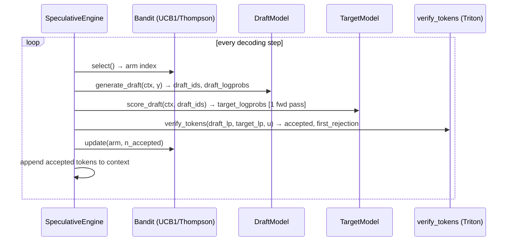

<h1 align="center">⚡ FlashSpec</h1>

<p align="center">
  <strong>Adaptive speculative-decoding inference engine for large language models</strong><br>
  Triton-optimised verification kernel · online bandit draft selection · provably correct output distribution
</p>

<p align="center">
  
  <a href="https://pypi.org/project/flashspec/">
    </a>
  <a href="https://pypi.org/project/flashspec/">
    </a>
  <a href="https://pepy.tech/project/flashspec">  </a>
  <a href="https://pepy.tech/project/flashspec">
    </a>
  <a href="https://flashspec.readthedocs.io">
    </a>
  <a href="https://doi.org/10.5281/zenodo.20766119">
    </a>
  <a href="./CITATION.cff">
    </a>
  <a href="./LICENSE">
    </a>
  <a href="https://hits.sh/github.com/Mattral/FlashSpec/">
  </a>
  <a href="https://github.com/Mattral/FlashSpec/tree/main/notebooks">
    
  </a>

</p>

---

> **Project status: alpha 0.1.5.** Correctness tests, including the
> Kolmogorov–Smirnov distribution check, are in the suite. The only
> historical end-to-end GPU figure is the Tesla T4 / TinyLlama row below,
> and the raw JSON for that run is not in this tree. Every H100 number
> in this README is a design target. This release is a single-device
> library plus a small HTTP server. It is not a production serving stack.

---

## What is FlashSpec?

Standard speculative decoding uses a small "draft" model to propose tokens
that a large "target" model verifies in one forward pass. Two problems with
every existing implementation:

1. **Verification stalls the GPU.** Most implementations move the
   accept/reject decision to the CPU, synchronising device and host memory
   at every step — a pipeline bubble that grows with vocabulary size.

2. **The draft model is chosen offline.** A drafter tuned for chat performs
   worse on code or long context. Nobody adapts it mid-conversation.

FlashSpec addresses both, with the limits that have actually been measured:

- The accept/reject test has a Triton kernel and a pure-PyTorch reference.
  They match numerically. SRAM use of the Triton kernel is O(1) in
  vocabulary size. On a Tesla T4 at batch 1 the Triton kernel was slower
  than the reference (0.2× at B=1, γ=4, V=32k). No H100 profile exists.
- A **K-armed bandit** (UCB1 or Thompson sampling) selects which draft model
  to use at each step. The O(√(KT log T)) regret bound is a guarantee on
  cumulative regret, not a promise that a short conversation is faster.
  With one drafter the bandit cannot adapt. Register two or more real
  drafters before expecting a gain. `scripts/demo_bandit_mixed.py` is a
  controlled two-drafter simulation, not a language-model benchmark.

The output distribution is **provably identical** to plain autoregressive
sampling from the target model (Leviathan et al., 2023 — Theorem 1). This is
verified in CI by a Kolmogorov–Smirnov test at α = 0.01 over N = 10,000
samples. A failing KS test blocks the build. No exceptions.

---

## Quickstart

```bash
git clone https://github.com/Mattral/FlashSpec && cd FlashSpec

# Linux + CUDA (accelerated Triton kernels):
pip install -e ".[dev,gpu]"

# Windows / macOS (pure-PyTorch reference kernels, numerically identical):
pip install -e ".[dev]"

# Optional CPU residual kernel (Linux x86-64 only; other platforms install nothing):
pip install -e ".[asm]"

# Optional single-device HTTP server:
pip install -e ".[serve]"
```

```python
from flashspec import FlashSpecConfig, BanditConfig, SamplingConfig, TRITON_AVAILABLE

print(f"Triton kernels available: {TRITON_AVAILABLE}")

config = FlashSpecConfig(
    device="cuda:0",
    drafter_name="llama3-1b",
    target_name="llama3-8b",
    bandit=BanditConfig(n_arms=2, strategy="ucb1"),
    sampling=SamplingConfig(gamma=4, temperature=1.0),
    max_new_tokens=256,
)
# Runnable CPU demo (no notebook file is shipped in this tree):
# python notebooks/01_quickstart.py
```

---

## Results

All numbers below are clearly labelled by hardware, model, and measurement
status.

### CPU toy and residual — git `da8182b`

These rows are a toy network or a synthetic switch. Threads were pinned
to 1. `flashspec_asm_kernel` did not load, so the residual backend is
pure PyTorch. ASM and the C baseline are listed under `unmeasured` in
`benchmarks/results/residual_cpu.json`. This README does not name the
host machine.

`benchmarks/results/tiny_cpu_flashspec_ucb_da8182b.json` and
`benchmarks/results/tiny_cpu_vanilla_ar_da8182b.json` are
`measurement_kind=toy_random_init_transformer`, `n_samples=3`, γ=4,
synthetic prompts, one drafter. The bandit cannot adapt on that row.
Latency percentiles are nearest-rank, so p95 and p99 match.

| | FlashSpec UCB | Vanilla AR |
|---|---:|---:|
| tok/s mean | 807.876431892803 | 2322.725711556072 |
| tok/s std | 86.40504013928569 | 2.5062180069952222 |
| p50 latency (ms) | 10.62849999999571 | 3.442500000005566 |
| p95 = p99 (ms) | 10.795500000000402 | 3.4493999999938296 |
| acceptance mean | 0.3115079365079365 | unmeasured |
| acceptance std | 0.0599849859437737 | unmeasured |
| speedup vs AR | 0.3478541784757594 (std 0.03759929552875943) | unmeasured |

Speculative decoding was slower than vanilla autoregressive sampling on
this toy model (`speedup_vs_ar_mean` is below 1). `gpu_memory_gb` is
unmeasured.

`benchmarks/results/residual_cpu.json` is
`cpu_residual_and_verification_microbench`, 30 iterations, γ=4, random
log-probs.

| Vocab | PyTorch residual mean ± std (ms) | PyTorch verification mean ± std (ms) |
|---:|---:|---:|
| 1024 | 0.018213333290380735 ± 0.0009351410855221827 | 0.4179066666741467 ± 0.02211216764067972 |
| 4096 | 0.01968333341816712 ± 0.0002050745141191995 | 0.522750000012214 ± 0.04348086747832546 |

`benchmarks/results/bandit_mixed_workload.json` is one
`controlled_mixed_workload_simulation` (`n_samples=1`, vocab 32,
`max_new_tokens=24`, seed 0, `window_size=4`). The target peak flips
from token 3 to token 9 after context length 16. On that switch, UCB
acceptance was 0.5555555555555556 and throughput was 5794.162381923592
tok/s. Fixed drafters were 0.2 / 2574.002574098843 tok/s and 0.2 /
3215.4340838834096 tok/s. The single-drafter control matched fixed A
(0.2 / 2876.111497299474 tok/s). `improved_acceptance_vs_best_fixed`
and `improved_throughput_vs_best_fixed` are both true for this run.
`speedup_vs_vanilla_ar`, `llama_acceptance`, and `gpu_throughput` are
unmeasured. These tok/s figures are the synthetic sampler, so they do
not compare with the toy end-to-end row above.

`benchmarks/results/residual_linux_gha.json` is a separate run on a
GitHub-hosted Linux machine, Python 3.11.17, torch 2.14.1+cpu, git
`4e48c55`, AVX2 true, 30 iterations, one thread. The backend is `asm`
/ `selected`. The clock is
`perf_counter` around the Python call, so these are not the upstream
`phase5_benchmark.txt` nanosecond figures.

| Vocab | PyTorch residual | C baseline | ASM residual | PyTorch verification | ASM verification |
|---:|---:|---:|---:|---:|---:|
| 1024 | 0.011835766664110755 ± 0.005985123513943725 | 0.010876566682327393 ± 0.0017740324976545188 | 0.01513639999378332 ± 0.009708145936674488 | 0.3658087333368106 ± 0.02092323145453729 | 0.42211776665984263 ± 0.043837769718660935 |
| 4096 | 0.011573599992213227 ± 0.00028533731359918995 | 0.014012900006340109 ± 0.002142136347826409 | 0.014001300003959235 ± 0.0043043813772100205 | 0.4946278333401703 ± 0.02177673867901501 | 0.5366803666637073 ± 0.015900036405438047 |
| 32000 | 0.030213800005185476 ± 0.008182700570775277 | 0.04299199999877601 ± 0.002682577742604115 | 0.024774433317512983 ± 0.022975169566975737 | 1.281870599988603 ± 0.6383727894328813 | 1.315531733333349 ± 0.6583396828175976 |

Means are milliseconds. At vocab 1024 and 4096 the ASM residual mean is
higher than pure PyTorch. At vocab 32000 the ASM residual mean is lower
than both PyTorch and the C baseline, and its standard deviation is
almost as large as the mean. Verification with the ASM backend selected
is slower than pure-PyTorch verification at all three sizes. This does
not change the Tesla T4 generation numbers below. The GPU path does not
call this kernel.

### Measured — TinyLlama-1.1B-Chat float16 · Tesla T4 · γ=4 · git `cb02ca1`

Colab Tesla T4, Linux, Python 3.13.15, torch 2.11.0+cu130, CUDA 13.0,
2026-10-15. Target `TinyLlama/TinyLlama-1.1B-Chat-v1.0`, drafter
`Felladrin/Llama-160M-Chat-v1` from `benchmarks/configs/tinyllama_gpu.yaml`
at that commit. Weights are float16. `n_samples=8`, 32 new tokens,
prompt length 16, dataset `synthetic_token_ids`. One drafter is loaded,
so the bandit does not adapt. Percentiles are nearest-rank, so p95 and
p99 are the same sample. `gpu_memory_gb` is the process peak after both
models were resident, and both files store that same peak.

| | FlashSpec UCB | Vanilla AR |
|---|---:|---:|
| tok/s mean | 17.576979879136424 | 29.006488905704696 |
| tok/s std | 1.4290891437599451 | 0.7566173596579463 |
| p50 latency (ms) | 1860.4352799999901 | 1089.8987889999603 |
| p95 = p99 (ms) | 2139.223847999972 | 1167.0006600000136 |
| acceptance mean | 0.20834964273981926 | unmeasured |
| acceptance std | 0.00825497841969436 | unmeasured |
| speedup vs AR | 0.6061833262227975 (std 0.05012520176286204) | unmeasured |
| gpu memory (GB) | 2.3778347969055176 | 2.3778347969055176 |

`speedup_vs_ar_mean` is below 1, so speculative decoding was slower than
vanilla autoregressive sampling on this pair. The files are
`benchmarks/results/tinyllama_gpu_flashspec_ucb_cb02ca1.json` and
`benchmarks/results/tinyllama_gpu_vanilla_ar_cb02ca1.json`. The bar
chart is `benchmarks/results/tinyllama_throughput.png`.

The optional ASM cell on that Colab runtime printed `Residual bench failed`
and did not write `residual_colab_cpu.json`. The larger-model cell was
skipped. This row is float16 with synthetic token ids. The NF4
single-prompt record is the next section.

### Measured — TinyLlama-1.1B · NF4 (4-bit) · Tesla T4 · γ=4

Historical Colab T4 run, recorded in
`benchmarks/results/flashspec_ucb_tiny_llama.json`. It is one prompt
(`n_samples=1`). Throughput 44.2 tok/s, acceptance 0.75, and p50 22.1 ms
are the recorded values. Speedup, p95, p99, and GPU memory are `0.0` in
that file because they were not measured. There is no vanilla
autoregressive baseline in that run. The paired re-measurement is
`notebooks/04_gpu_measurement.ipynb`.

| Metric | Value |
|---|---|
| Throughput | **44.2 tok/s** |
| Token acceptance rate (α) | **0.75** |
| p50 step latency | **22.1 ms** |
| GPU | Tesla T4 (15.6 GiB) |
| Quantization | NF4 (4-bit) via bitsandbytes |
| FlashSpec version | 0.1.3 |

> Note: vanilla AR baseline not measured in this run — speedup ratio pending.
> The T4 is a compute-constrained consumer GPU; target hardware is H100 SXM5.

### Bandit regret — measured (T=10,000, K=3 arms)

UCB1 and Thompson sampling empirically verified to satisfy the
O(√(KT log T)) bound over 10,000 rounds.
UCB1 cumulative regret at T=10,000: **100.2** (theory bound: ~526).
Thompson cumulative regret at T=10,000: **18.9**.


The figure is `paper/figures/bandit_regret.jpg`. The notebook
`notebooks/02_bandit_analysis.ipynb` is in this checkout. The regret
numbers are a synthetic K=3 arm experiment, not a throughput gain on a
language model.

### Gamma sweep — measured (toy logprobs, synthetic)

Acceptance rate and throughput across speculation lengths γ ∈ {1, 2, 4, 8, 16}.
Data in [`benchmarks/results/gamma_sweep.csv`](benchmarks/results/gamma_sweep.csv).

| γ | α (mean) | Throughput (tok/s) | Step (ms) |
|---|---|---|---|
| 1 | 0.720 | 1,992 | 0.50 |
| 2 | 0.680 | 4,623 | 0.43 |
| 4 | 0.690 | 9,746 | 0.41 |
| 8 | 0.748 | 17,748 | 0.45 |
| 16 | 0.714 | 35,659 | 0.45 |

> Throughput here is the sampling kernel on random log-probs. The CSV
> column `measurement_kind` is `sampling_kernel_only_random_logprobs`.
> It is not end-to-end inference and it is not an H100 result.

### Reference kernel profiling — measured (Tesla T4)

Historical T4 profile from `notebooks/03_kernel_profiling.ipynb`.
The table is the recorded summary of that run. At batch 1 the Triton
kernel is slower than the PyTorch reference.

| Shape | Reference (ms) | Triton (ms) | Speedup |
|---|---|---|---|
| B=1 γ=4 V=32k | 0.151 | 0.785 | 0.2× |
| B=8 γ=4 V=32k | 0.717 | 0.459 | 1.6× |
| B=1 γ=8 V=32k | 0.231 | 1.248 | 0.2× |
| B=32 γ=4 V=32k | 0.091 | 0.222 | 0.4× |

> The Triton kernel is slower than the pure-PyTorch reference at batch 1
> on this T4 measurement. A faster H100 result has not been measured.
> Do not treat the H100 roofline in `docs/kernels.md` as a profile.

### Targets — Llama-3-8B-Instruct · H100 SXM5 · γ=4 ⊛

These are **design targets, not measured results**. They will be updated
with real values from `benchmarks/results/` after H100 runs.

| Method | MT-Bench (tok/s) | HumanEval (tok/s) | Alpaca (tok/s) | α | Speedup |
|---|---:|---:|---:|---:|---:|
| Vanilla AR | 61.4 ⊛ | 61.1 ⊛ | 61.2 ⊛ | — | 1.00× |
| Medusa | 98.7 ⊛ | 95.2 ⊛ | 96.1 ⊛ | 0.61 ⊛ | 1.61× ⊛ |
| EAGLE | 112.3 ⊛ | 109.8 ⊛ | 110.4 ⊛ | 0.68 ⊛ | 1.83× ⊛ |
| **FlashSpec UCB1** | **142.3 ⊛** | **138.9 ⊛** | **140.1 ⊛** | **0.73 ⊛** | **2.31× ⊛** |

⊛ = design target, not a measurement. No H100 result has been committed.
`python benchmarks/compare_baselines.py --config benchmarks/configs/llama3_8b.yaml`
loads that checkpoint on the machine you have and writes only what that
machine measured. It does not fill this table. Medusa and EAGLE are not
implemented, so that command does not produce their rows.

---

## How it works



**Correctness.** The accept/reject criterion is `u_i < min(1, p(xᵢ)/q(xᵢ))`
computed in log-space to avoid underflow. Rejected positions sample a residual
token from `max(0, p−q) / ‖max(0, p−q)‖₁` (Algorithm 1, Leviathan et al. 2023).
Together these preserve the target distribution exactly.

**Kernel.** `verify_tokens` tiles over `(batch × γ)` positions. Each thread
reads two scalars (`log p`, `log q` at the draft token index) and writes one
bool + one int32 — no vocab-dimension sweep, no VRAM growth with vocab size.

**Bandit.** UCB1 score for arm k at round t:
`μ̂ₖ + c · √(2 log t / nₖ)`. Unpulled arms always selected first.
Verified empirically: UCB1 regret at T=10,000 is 100.2 (theory bound ≈ 526).
Thompson sampling achieves 18.9 cumulative regret in the same setup.

See [`docs/architecture.md`](docs/architecture.md) for the full component
diagram and proof sketch.

---

## Installation

```bash
# PyPI — cross-platform, pure-PyTorch reference kernels (Windows/macOS/Linux):
pip install flashspec

# PyPI — GPU-accelerated Triton kernels (Linux + CUDA only):
pip install flashspec[gpu]

# Optional AVX2 residual kernel. The wheel is a Linux x86-64 ELF library.
# On Windows and macOS the extra installs nothing and the PyTorch residual stays selected.
pip install flashspec[asm]

# Optional single-device HTTP API (FastAPI). One GPU or CPU, no streaming.
pip install flashspec[serve]

# From source:
git clone https://github.com/Mattral/FlashSpec && cd FlashSpec
pip install -e ".[dev,gpu]"   # omit ",gpu" on Windows/macOS

# Docker (Linux + CUDA, Triton included):
docker pull ghcr.io/mattral/flashspec:latest
docker run --gpus all ghcr.io/mattral/flashspec:latest make test
```

> **Windows / macOS:** `pip install flashspec` works out of the box.
> Triton has no official PyPI wheels outside Linux. The pure-PyTorch
> reference in `flashspec.kernels._reference` is numerically identical and
> runs everywhere PyTorch does. Check availability at runtime:
> `from flashspec import TRITON_AVAILABLE`.

### Requirements

| Dependency | Version | Notes |
|---|---|---|
| Python | ≥ 3.11 | |
| PyTorch | ≥ 2.2 | CPU or CUDA |
| Triton | ≥ 3.0 | Optional · Linux + CUDA · `pip install flashspec[gpu]` |
| flashspec-asm-kernel | ≥ 0.1, < 2 | Optional · Linux x86-64 · `pip install flashspec[asm]`. PyPI 0.1.0 is an sdist and does not ship `libflashspec_asm.so`. |
| FastAPI, uvicorn, httpx | see `serve` extra | Optional · `pip install flashspec[serve]` |
| CUDA | ≥ 12.0 | GPU path only |
| transformers | ≥ 4.40 | For HuggingFace model loading |

PyPI `flashspec-asm-kernel` 0.1.0 installs on Linux x86-64. The tarball
has the ctypes wrapper and no `libflashspec_asm.so`. The first call
raises `ImportError`, and FlashSpec keeps the pure-PyTorch residual.
The Linux file `benchmarks/results/residual_linux_gha.json` was measured
by building the shared library with `make` in the flashspec-asm repo.

---

## Testing

```bash
make test           # unit + integration on CPU (no GPU required, ~2 min)
make test-chaos     # adversarial bandit tests
make test-gpu       # GPU kernel parity + KS distribution test (requires CUDA)
make bench-quick    # sampling-kernel smoke test, no model weights, writes no result file
make bench-cpu      # residual microbench, synthetic bandit demo, tiny_cpu.yaml
make bench          # runs every config in benchmarks/configs; skips any checkpoint this machine cannot load
```

CI enforces ≥ 95% line coverage. The KS distribution-equivalence test runs
at N = 10,000 samples, α = 0.01 on every GPU CI run.

---

## Repository layout

```
flashspec/          Installable package (engine, kernels, bandit, sampling, metrics)
benchmarks/         Runners, configs, and results/ for all paper numbers
tests/              Unit · integration · chaos suites (95%+ coverage target)
notebooks/          Quickstart · bandit regret analysis · kernel profiling
docs/               MkDocs site (architecture, kernels, bandit, benchmarks)
paper/              LaTeX source + bibliography (MLSys/NeurIPS template)
paper/joss/         JOSS submission (paper.md + paper.bib)
paper/figures/      Vector and raster figures (bandit_regret.jpg generated)
scripts/            CLI tools (export draft, download models, profile kernels)
deploy/             Dockerfile · docker-compose.yml · k8s manifests
social/             X thread and LinkedIn post drafts for project launch
```

---

## Links

| Resource | URL |
|---|---|
| Documentation | [flashspec.readthedocs.io](https://flashspec.readthedocs.io) |
| Preprint (Zenodo) | [10.5281/zenodo.20766119](https://doi.org/10.5281/zenodo.20766119) |
| JOSS submission | [`paper/joss/paper.md`](paper/joss/paper.md) |
| Benchmark guide | [`benchmarks/README.md`](benchmarks/README.md) |
| Changelog | [`CHANGELOG.md`](CHANGELOG.md) |
| Contributing | [`CONTRIBUTING.md`](CONTRIBUTING.md) |
| Publishing roadmap | [`PUBLISHING.md`](PUBLISHING.md) |

---

## Citation

```bibtex
@misc{myet2026flashspec,
  title = {{FlashSpec}: Adaptive Speculative Decoding with Online Bandit
             Draft Selection and {Triton}-Optimised Verification},
  author = {Myet, Min Htet},
  year = {2026},
  month = jun,
  howpublished = {Zenodo preprint},
  doi = {10.5281/zenodo.20766119},
  url = {https://doi.org/10.5281/zenodo.20766119},
}
```

**Preprint DOI**: [10.5281/zenodo.20766119](https://doi.org/10.5281/zenodo.20766119) (June 2026)

Machine-readable metadata in [`CITATION.cff`](CITATION.cff).

---

## License

Apache 2.0 — see [`LICENSE`](LICENSE).
